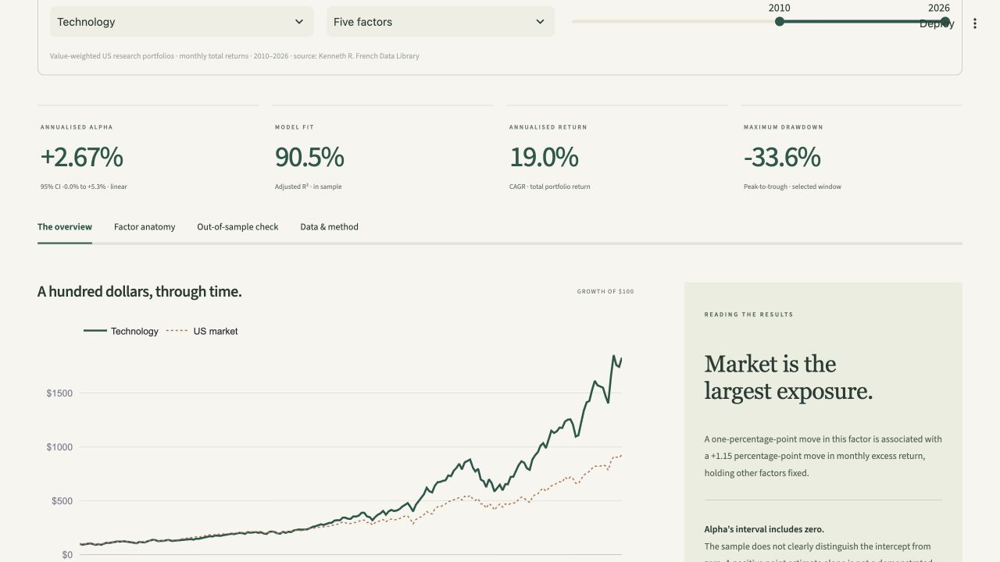

# FactorLens

[Open the live Streamlit app](https://c2umdutfhvj2uw9gyb9x8c.streamlit.app/)



FactorLens examines monthly returns for ten US industry portfolios. It fits factor
models, reports uncertainty, and checks whether the fitted relationships hold up
outside the estimation period.

## Run locally

Python 3.11 is the tested runtime.

```bash
python -m venv .venv
source .venv/bin/activate
python -m pip install -r requirements.txt
python -m streamlit run app.py
```

The bundled French Data Library snapshot opens without a network connection or
API key. Industry, model and date filters stay available in the sidebar as you
move between pages.

## Pages

- **Overview:** growth of $100, annual returns, drawdowns and an interpretation of
  the fitted intercept and its confidence interval.
- **Factor exposures:** slopes with HAC intervals, trailing exposures, monthly
  attribution, and a comparison of all ten industries.
- **Risk and returns:** empirical monthly VaR and expected shortfall, return
  distributions, calendar heatmap, rolling volatility/Sharpe, drawdown recovery
  episodes, and industry correlations.
- **Model diagnostics:** residual plots, autocorrelation, normal Q-Q plot, VIF,
  factor correlations, Ljung-Box, Breusch-Pagan and Jarque-Bera tests.
- **Validation:** a fixed chronological holdout and rolling or expanding
  walk-forward refits. Specifications are compared on identical test months.
- **Data and methodology:** source definitions, equations, provenance, refresh,
  monthly observations and a downloadable research note.

These are separate Streamlit pages with their own URLs. Only the selected page
runs; expensive rolling calculations are cached.

## Calculation notes

The source is the [Kenneth R. French Data Library](https://mba.tuck.dartmouth.edu/pages/faculty/ken.french/data_library.html).
The app uses US factors and the first, value-weighted monthly block of the ten
industry portfolios. Snapshot metadata records retrieval time and source archive
hashes. Percentages become decimal returns once, missing-data sentinels are removed,
and the combined monthly series is checked for gaps.

OLS fits industry returns less RF against an intercept and the selected factors.
Intervals use Newey-West/HAC standard errors with three lags. Alpha is 12 times the
monthly intercept. CAGR compounds total returns; the two quantities are different.
The market total return is Mkt-RF plus RF. Drawdowns include starting capital, and
recovery tables retain unrecovered episodes.

Monthly loss is minus monthly return. Historical VaR is the chosen empirical loss
quantile; expected shortfall averages losses at or above it. Tail estimates depend
strongly on the period and number of observations. No normality assumption is used
for these estimates.

The attribution components add to each observed monthly excess return. The
full-sample decomposition uses coefficients fitted on that same sample.
Chronological validation and walk-forward fits use only earlier returns to estimate
coefficients, then use the **realised factors of the test month** to explain its
return. This evaluates attribution stability, not a tradable forecast. The page
reports training end dates so this distinction can be checked.

Diagnostic tests have their own assumptions and can produce false positives when
several are inspected. HAC covariance does not repair a misspecified model.
Research portfolios are not directly investable, costs are not included, and source
history can be revised.

## Refresh and verification

On Data and methodology, Refresh downloads and validates both official source
archives before replacing one local bundle atomically. A failed refresh keeps the
previous dataset. The live bundle is ignored by Git and may disappear on a host
restart; the committed snapshot remains available.

```bash
python -m unittest test_research.py
```

The suite checks parsing and units, known coefficients, holdout and walk-forward
isolation, initial drawdown/recovery, attribution reconstruction, empirical tail
losses, VIF sensitivity, snapshot completeness and all six pages. GitHub Actions
runs the same suite after a fresh dependency install.

For Streamlit Community Cloud, select `main`, `app.py`, and Python 3.11. No secrets
are needed. `render.yaml` is an optional paid always-on configuration; committing
it does not create a service. Code is MIT-licensed; public data retains its
upstream attribution and terms.
